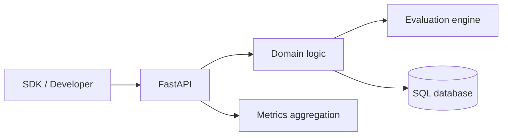

# Architecture

TraceForge is a modular FastAPI service backed by SQLAlchemy.

## Current implementation

- API routes handle trace ingestion, retrieval, metrics, prompt versions and evaluations.
- SQLAlchemy models persist traces, prompt versions and evaluation runs.
- Evaluation functions are deterministic and dependency-free.
- SQLite is the zero-configuration local default; PostgreSQL can be selected through `DATABASE_URL`.

## Deliberate scope

This first release uses synchronous request handling and inline evaluation execution. A distributed worker and Redis-backed queue are not yet implemented; they are a planned extension, not a claimed feature.
